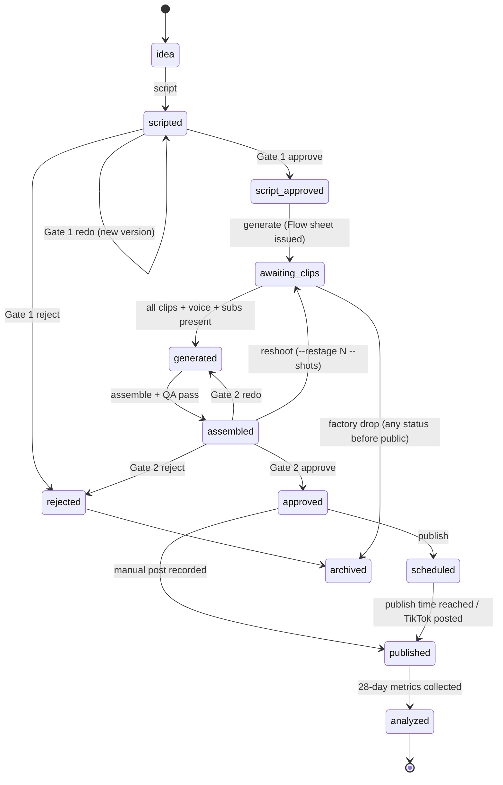

# ARCHITECTURE.md

*Last updated: 2026-10-23*

## 1. Big picture

The factory is a **Python command-line program** called `factory`, with one subcommand per pipeline stage. Every stage reads its work from the SQLite database, does one job, writes results back, and moves each content item to its next **status**.

Because the state lives in the database rather than in memory, any stage can be re-run safely (that's what **idempotent** means), and a crash never loses work.

```mermaid
flowchart LR
    subgraph Local PC (WSL2)
        D[discover] --> I[ideate] --> S[script]
        S --> G1{{Gate 1<br/>script review}}
        G1 -- approve --> GEN[generate]
        G1 -- redo --> S
        GEN --> FLOW[/Owner generates clips<br/>in Google Flow/]
        FLOW --> GEN
        GEN --> A[assemble]
        A --> G2{{Gate 2<br/>final review}}
        G2 -- approve --> P[publish]
        G2 -- redo --> GEN
        P --> L[learn]
        L -. winning patterns .-> I
        DB[(SQLite<br/>data/factory.db)]
        FS[(Assets<br/>data/assets/)]
    end
    subgraph Cloud services
        GEM[Gemini API]
        YT[YouTube Data +<br/>Analytics API]
        TT[TikTok<br/>manual post, D-116]
        TG[Telegram Bot API]
        WIKI[Wikimedia<br/>Pageviews API]
        GD[Google Drive<br/>backup]
    end
    D --- WIKI & YT
    I --- GEM
    S --- GEM
    G1 --- TG
    G2 --- TG
    P --- YT & TT
    L --- YT & TT
```

**Who runs it:**
- Phase 1: the owner, by typing commands.
- Phase 2 onward: **Windows Task Scheduler**, which calls `wsl.exe` at 01:00 (production batch) and 06:00 (analytics).
- n8n (a visual workflow tool) is optional from Phase 2, only as a dashboard and trigger. All business logic stays in Python.

## 2. Pipeline stages

| Stage | CLI | Input | Output | Status change | Free tool (launch) | Paid upgrade (approx./month) |
|---|---|---|---|---|---|---|
| **discover** | `factory discover` | Channel `seed_topics` (+ optional `wikipedia_articles`) | Rows in `trend_signals`: Wikipedia views and trend ratio daily, YouTube median views about weekly (D-078); `factory status --signals` shows the top 10 | — | Wikimedia Pageviews API; YouTube Data API `search.list` / `videos.list`; Google Trends CSV exported manually by the owner (`factory trends import`) | Not needed |
| **ideate** | `factory ideate`, then `factory plan --week next` | Signals, machines already covered (winning patterns from Phase 3) | `contents` rows (score ≥ 65) with `angle`, score breakdown and `content_signals` links; the plan sets `planned_publish_at`, `hook_type`, `beat_order` (D-080) | new → `idea` | Gemini API free tier; Ollama fallback | Claude API, about €3–8 |
| **script** | `factory script` | `idea` contents that are in a weekly plan, or have no score (created with `factory new`); planned items must use the plan's hook and beat order (D-080) | `scripts`, `sources`; Gate 1 request | `idea` → `scripted`; blocklisted topic or similarity above the threshold → `archived` | Gemini; local embeddings (`all-MiniLM-L6-v2`) for the similarity check | Claude API |
| **review (Gate 1)** | `factory review --gate script` | `scripted` | `reviews` row | → `script_approved` / `rejected` / back to `scripted` | Terminal, or Telegram buttons via `factory bot` (task 2.1) | — |
| **generate** | `factory generate` | `script_approved` | Flow prompt sheet, voiceover, subtitles, stills, diagrams; for a **blueprint** item (D-111) voiceover, subtitles and `blueprint.mp4` (drawn by code, no Flow) | → `awaiting_clips` (sheet + voice + subtitles issued) → `generated` (all clips in the inbox, then animated stills and diagram cards made); a blueprint item goes through both in one run, or waits at `script_approved` if its machine has no drawing yet | Google Flow (manual, Veo 3.1 Fast); Kokoro-82M; faster-whisper; Pillow; FLUX.1-schnell or Flow for stills | Google AI Pro for more Flow credits, about €22; ElevenLabs Starter, about €6 |
| **assemble** | `factory assemble [--force]` | `generated` | `render_youtube.mp4`, `render_tiktok.mp4`, `preview_720p.mp4`, `music.txt`, `cover.jpg`, `qa_report.json`; `metadata.json` (task 1.11) | QA pass → `assembled`; QA failure → stays `generated` with the reasons in `status_reason` (renders are kept, so a re-run only re-checks) | FFmpeg only (D-068) | Not needed |
| **review (Gate 2)** | `factory review --gate final` | `assembled` | `reviews` row | → `approved` / `rejected` / back to `generated` | Terminal, or Telegram buttons via `factory bot` (task 2.1) | — |
| **publish** | `factory publish --id N` (YouTube, task 2.3, D-115); `factory publish --check`; `factory publish --manual` (D-072) | `approved` | `posts` rows | YouTube upload → `scheduled`; `--check` after it went public → `published`; a manual post goes `approved`/`scheduled` → `published` | Phase 1: you upload by hand, the factory records it. Phase 2: YouTube Data API (scheduled private → public); TikTok stays a manual post recorded with `--manual` (D-116) | Not needed |
| **learn** | `factory learn [--id N]` (YouTube Analytics pull, task 2.5, D-117; also refreshes labels); `factory labels show/set`, `factory report weekly` (task 2.9, D-119) | `published` posts | `metrics` (`source = api` at the 24h/72h/7d/28d checkpoints, once final), `performance_labels`, weekly report | → `analyzed` (after 28-day metrics) | YouTube Analytics API; TikTok numbers by hand or from the weekly TikTok Studio CSV (no TikTok API, D-116) | Not needed |

Helper commands:
- `factory db init|migrate|backup`
- `factory new --object <name> --format <short|deep_dive> --pillar <id>`: creates a content item by hand as an `idea` (the format must be enabled and the pillar defined in the channel YAML; the object is trimmed and lowercased). `--style flow|blueprint` overrides the channel's `video_style` (D-111); `factory status <id>` shows the style.
- `factory series new --object <machine> [--parts 3-5] [--format short] [--pillar ...] [--teaser <id>]` / `factory series show <id>`: one topic as linked videos (D-112): one `idea` item per part of the machine's blueprint drawing, in order, each with its focus as the angle; scripts, films, titles and descriptions use the series (CONTENT_STRATEGY §13).
- Every command stops with "run `uv run factory db init`" when the database is older than the newest migration (D-112).
- `factory style <id> flow|blueprint`: switches an item's picture style while it is `idea`, `scripted`, `script_approved` or `awaiting_clips` (before its pictures exist, D-111).
- `factory plan --week next|this`: fills the week's `cadence.weekly_plan` slots with the best unplanned ideas (no pillar 3 days in a row; hook type and beat order differ from the day before) and prints the plan; slots already planned are kept (D-080).
- `factory generate --restage N [--shots 3|2,4]`: new film shots (Gemini) for an approved item that has no clips yet: the narration stays, the clip prompts and (for `awaiting_clips`) the Flow sheet are rewritten (D-092). With `--shots` only those clips are rewritten; the hero_look and the other clips stay (D-096). On a `generated` or `assembled` item `--shots` is a **reshoot** (D-107): the kept clips go back to the inbox, the redone ones stay there as `old_shot_NN.mp4`, renders and the QA report are removed and the item waits for clips again.
- `factory clips review <id> [--shots 3|2,4]`: Gemini watches each clip (`shot_NN.mp4`, in the inbox or the project's `clips/`) and frame image (`frame_NN.png/.jpg/.webp`, the free Flow image made first) and checks it against its prompt and the film rules: pass/fail, score 1–10, problems, fix. Since D-104 it reviews the chain's images (`image_NN.png`, each once) and the clips. Advice only, no status change; every review is appended to `clip_review.json` (D-097). A file saved before its current prompt was issued (`flow_issued.json`) is flagged ⚠ (D-098). Since D-109 only **visible problems** fail a clip (expert construction details are notes), each file gets up to 3 votes and the majority decides, and a changed "Rules from earlier clips" line alone doesn't count as a new prompt.
- `factory drop <id> --reason "..."`: drops an item that is not public yet: it becomes `archived` with the reason, and every stage ignores it (D-093).
- `factory flow-log --credits N`: logs Flow credits you spent (refused above `budgets_per_day.flow_credits`).
- `factory bot [--find-chat-id]`: the Telegram review bot for both gates, plus alerts (§3, task 2.1). `--find-chat-id` prints the chat id of whoever sent the bot a message, for `TELEGRAM_ALLOWED_CHAT_ID` in `.env`.
- `factory voice audition [--voices a,b,c] [--text ...|--content-id N]`: the same text read by several Kokoro voices into `data/audition/voice_<id>.wav`, to choose `voice.voice_id`.
- `factory voice render <content_id>`: the current script as `voice.wav` (48 kHz, −14 LUFS), `voice_words.json` and word-highlight `subs.ass` in the item's asset folder, plus `assets` rows (`voiceover`, `subtitles`). The generate stage calls the same code.
- `factory voice preview <content_id>`: `subs_preview.mp4` (540×960, voice + burned-in subtitles) to check the subtitles on a phone.
- `factory music add <file> --title ... [--artist ... --attribution ... --license-url ... --mood ...]` / `factory music list`: the YouTube Audio Library tracks used in YouTube renders (copied into `assets_static/music/youtube_audio_library/`, recorded in `music_tracks`, picked least-used first).
- `factory brand build`: rebuilds `assets_static/logo/` (logo, avatar, stings) from the channel's `display_name` and `brand.palette`.
- `factory publish --id N [--at "YYYY-MM-DD HH:MM"]` (D-115): needs `DRY_RUN=false` (otherwise it only prints the file, title and time), YouTube `publish_mode: api_scheduled`, a standing Gate 2 approval and no YouTube post yet. Uploads `render_youtube.mp4` as **private** with `publishAt` and `containsSyntheticMedia=true`, title, description and tags from `metadata.json`; stores the post as `scheduled` and the item becomes `scheduled`. The time: `--at` (channel time zone, at least 15 min ahead), else `planned_publish_at` if still ahead, else the next day at `cadence.publish_time`; a local day that already has a YouTube post is never used (one per day). `factory publish --check` records the scheduled videos YouTube shows as public as `published` (read-only, also in DRY_RUN). TikTok stays manual (D-116: TikTok doesn't approve API apps for personal use).
- `factory publish --manual --id N`: prints the upload kit (render paths, YouTube title and description, TikTok caption, the AI-label steps). `factory publish --manual --id N --platform youtube|tiktok --url <link> --ai-label-on` records the live post in `posts`; the first one moves the item to `published` (D-072).
- `factory auth youtube`: signs the channel in to YouTube (link for the Windows browser), checks the account is `@coilandcog` and saves the token in `secrets/<slug>/google_token.json`. `factory auth test-upload` (with `DRY_RUN=false`) uploads the brand sting **unlisted** and AI-labelled to prove the upload path; delete it in Studio afterwards (D-102). `--scheduled` makes it private with `publishAt` 30 days ahead instead (D-115); it must be deleted before then.
- `factory learn [--id N]` (D-117): for every real, published YouTube post (or item N), pulls each checkpoint that is final from the YouTube Analytics API into `metrics` (`source = api`): a checkpoint covers the US Pacific days from going public to the end of its window and is final 2 days after that. First it corrects `posts.published_at` to YouTube's `publishedAt`. API numbers replace typed ones, except stayed-to-watch, which the API lacks. Read-only (works in DRY_RUN); prints saved/waiting checkpoints and the `metrics show` table.
- `factory labels show` / `factory labels set <id> winner|average|loser|auto [--note ...]` (D-119): winner/average/loser from each real YouTube video's 7-day numbers (CONTENT_STRATEGY §10, channel median = median 7-day views of the labelled videos; no stayed-to-watch → at most `average`) into `performance_labels`; an owner's label is kept on every recompute until `auto`.
- `factory report weekly [--no-send]` (D-119): last week's (Mon–Sun, channel time) posts, winners and losers with their numbers, patterns per pillar / hook type / format (median 7-day views and W/A/L counts, never "copy this video") and a to-do list (missing stayed-to-watch, videos waiting for 7-day numbers); refreshes labels first and sends it to `TELEGRAM_ALLOWED_CHAT_ID` ("[DRY RUN]" prefix in dry run). The Monday 06:00 run is task 2.11.
- `factory metrics add <id> --platform youtube|tiktok --checkpoint 24h|72h|7d|28d [--views --stayed --avd-pct --avd-s --likes --comments --shares --subs --watch-min]` / `factory metrics show <id>`: numbers copied by hand from YouTube Studio or TikTok into `metrics` (`source = manual`); entering a checkpoint again replaces only the numbers given. Learning from results starts before the Analytics API (D-101).
- `factory lessons learn|list|approve <n> [--text ...]|remove <n>`: Gemini turns failed clip reviews (every item's `clip_review.json`, each failure once) into short general lessons; only lessons you approve go into the film rules (new scripts, restages) and into `clips review`'s checks (clip lessons for clips, frame lessons for frames) (D-103).
- `factory references add [--for N]|list|approve <n> [--note ...]|remove <n>`: the reference library: Gemini writes style notes (lighting, camera, composition, motion, materials, 3–6 prompt phrases) about images and clips you drop into `data/inbox/references/`; the files move to `data/references/` and are never used in a video; only notes you approve (newest 8) join the film rules for new scripts and restages (D-100); with `--for N` a note only shapes item N (D-104). For videos Gemini also listens: hook, narration, structure, pacing, sound, why it works and topic ideas; approved video notes feed script writing (storytelling) and ideation (topic ideas); a video too big to send (over 18 MB) is shrunk whole, with its sound, to fit (up to 10 min; longer ones keep their first 10 min) (D-109).
- `factory metrics import-tiktok [<file.csv> ...]` (D-120): loads TikTok Studio Content CSVs (every CSV in `data/inbox/tiktok/` when no file is given; those move to `imported/`). Each row (views, likes, comments, shares; no watch time) is matched to its TikTok post by the video number in the link and stored as `source = csv` under the latest checkpoint the video had reached at the file's time (9 days old → `7d`; under 24 h → not stored); a checkpoint that already has numbers, typed or imported, is kept, so importing twice changes nothing. Unrecorded videos and broken files are listed by name.
- `factory trends import`: loads Google Trends CSV files you downloaded into `data/inbox/trends/` (weekly, about 5 minutes).
- `factory retry <content_id>`
- `factory status [<content_id>]`
- `factory run-nightly`: runs discover → ideate → script → generate (voice/subs) → assemble for items whose clips are present → review notifications.

## 3. Human-in-the-loop gates

| Gate | When | What the owner sees | Buttons |
|---|---|---|---|
| **Gate 1: Script** | Before any Flow credits are spent | Title, hook, full script, Engineer's Note draft, shot list, sources, score | Approve / Reject (with reason) / Redo |
| **Gate 2: Final** | After assembly and automated QA | 720p preview MP4, cover, title, captions, hashtags, checklist (incl. the platform AI labels) | Approve / Reject (with reason) / Redo |

- Reject reasons are stored in `reviews.reason` and fed to the learn stage.
- **Pre-check at Gate 1 (task 2.22, D-118):** above every Gate 1 script (terminal and Telegram) a PRE-CHECK block lists problems in the final narration: a blueprint item's numbers that aren't in its drawing's verified facts (code), and from one Gemini call claims that are wrong or unsupported by the facts and sources, blocklist topics and, in a series, later parts explained too early. Approving checks again with your note in the text; open problems need **approve anyway** (terminal question, `--approve-anyway`, or the Telegram button) and are stored as the review's reason. Results are cached per text in `script_precheck.json`; when Gemini can't run, the code check still shows and the block says "claim check skipped".
- **Gate 1 in the terminal (task 1.5):** `factory review --gate script` walks through every `scripted` item: it shows the script, then asks approve / reject / redo / skip / quit. **Approve** opens the Engineer's Note in `$EDITOR` (pre-filled with the AI draft); an unchanged draft needs an explicit "keep it" confirmation. The note replaces the draft inside `scripts.body_text`, word count and duration are recalculated, and a word-range miss is a warning, not a block. **Reject** and **redo** need a reason. **Redo** immediately writes the next script version with Gemini (the feedback and the previous narration go into the prompt) and shows it for review; the previous version stays as history, and if generation fails it stays current. Flags (`--id N --decision approve|reject|redo --reason ... --note ...|--keep-note`) do the same without the menu; the Telegram bot calls the same functions (D-061).
- **Gate 2 in the terminal (task 1.11):** `factory review --gate final` walks through every `assembled` item: title, TikTok caption, full YouTube description, music track, the QA report, the Explorer command to open `preview_720p.mp4` and `cover.jpg`, and the human checklist (TESTING §4). Choices: **approve** (only after confirming the checklist → `approved`), **edit** (`metadata.json` in `$EDITOR`, saved only if it still passes the rules), **reject** (reason → `rejected`), **redo** (reason → back to `generated`, renders/preview/QA report removed so the next `factory assemble` re-renders and re-checks), skip, quit. Flags: `--id N --decision approve --checklist-ok` / `reject|redo --reason ...` (D-071).
- **Both gates in Telegram (task 2.1):** `factory bot` is a long-running process (stop it with Ctrl+C) that uses long polling, so no public server is needed. It only listens to `TELEGRAM_ALLOWED_CHAT_ID`; updates from other chats are logged and ignored, with no reply. At start, and then about every 30 s, it sends each waiting item once per session: Gate 1 as the same text the terminal shows (split into parts over 4,096 characters) with **Approve / Reject / Redo / Skip**; Gate 2 as `preview_720p.mp4` (sendVideo), then the Gate 2 text and checklist with **Approve / Reject / Redo / Edit metadata / Skip**. **Approve at Gate 1** sends the AI draft note: you reply with your own note, or press **Keep this draft**. **Approve at Gate 2** first shows the checklist, and only **✅ All checked: approve** approves. **Reject** and **redo** ask for a reason (your next message; `/cancel` stops). Gate 1 redo writes the next version and sends it as a new review. **Edit metadata** stays in the terminal, where the rules are checked. Every press first checks that the item is still waiting, so an old button on an item decided elsewhere does nothing. Decisions are stored with `reviews.channel = telegram` and the review message's `telegram_message_id`, and the buttons are removed from that message. Commands: `/pending` (show everything again), `/cancel`, `/help`. **Alerts:** runs that end `failed` or `partial` after the bot started (budget stops included) and items that newly become `failed`, each once (D-082).
- Gate 2 is **never** removed.
- Gate 1 is never fully automatic, because the Engineer's Note needs the owner. In Phase 3 it can switch to `batch_weekly`, where the whole week's scripts are reviewed in one session. The conditions are in `ROADMAP.md`.

## 4. Deployment

| Piece | Runs where | Why |
|---|---|---|
| Python pipeline, SQLite, assets | Owner's PC, inside WSL2 Ubuntu | €0; the PC can run overnight |
| Image and video generation | Cloud (Google Flow, by hand) | No NVIDIA GPU on the PC |
| Voiceover, subtitles, editing, embeddings | Local CPU | Free, unlimited, licensed for commercial use |
| LLM | Gemini API (cloud); Ollama locally as fallback | The free tier covers our volume |
| Scheduling | Windows Task Scheduler → `wsl.exe -d Ubuntu -- bash -lc "cd ~/ai-content-factory && uv run factory run-nightly"` | `cron` inside WSL only runs while WSL is awake |
| Posting at 17:00 | YouTube's own scheduled publishing (`publishAt`) | The PC doesn't need to be on at 17:00 |
| n8n (optional, Phase 2+) | Docker Desktop with WSL integration | A visual dashboard only |
| Backup | Nightly: `factory.db` snapshot plus `config/` to the channel's Google Drive | Survives a laptop failure |

## 5. Scheduling

| Time (Europe/Berlin) | Job | Phase |
|---|---|---|
| 01:00 daily | `factory run-nightly` (production batch, then Gate notifications) | 2+ |
| 06:00 daily | `factory learn` (analytics pull, labels); Mondays also `factory report weekly` | 2+ |
| 02:30 daily | `factory db backup` | 2+ |
| 17:00 daily | Publishing is done by YouTube itself; TikTok drafts are posted by the owner | 2+ |

## 6. Failure handling and cost control

- **Idempotent stages.** Each stage selects items by status and writes outputs to deterministic paths. Re-running a stage skips finished work.
- **Retries.** Only `RetryableError` (network errors, HTTP 429, 5xx) is retried: 1 try plus 3 retries (4 attempts in total), with exponential backoff waits of 2 s, 4 s and 8 s plus jitter. Client SDKs' own retries stay off, so every attempt passes through the budget check. After that the item's status becomes `failed` (the previous status is kept in `status_before_failure`) and a Telegram alert is sent.
- **Budgets.** `budgets_per_day` in the channel YAML. Each external call records its usage in `api_usage`. A stage raises `BudgetExceededError` and stops **before** going over budget.
- **`DRY_RUN=true`** (the default) does everything except external writes: no uploads and no public posts. Telegram messages are still sent and are marked "[DRY RUN]".
- **Run log.** Every command invocation creates a `runs` row (`running` → `ok` / `failed` with the error text, secrets masked) and writes JSON-lines logs; the row id is the `run_id` in every log line. Two exceptions: `factory config check` writes only a log line (it must work while the config, and so the database location, is broken), and `factory db init` writes its row after the migrations, because the `runs` table doesn't exist before. Other commands stop with "run `factory db init` first" if there's no database.
- **`DRY_RUN`** comes from `.env` or the environment. Missing means `true`; anything other than `true`/`false` is a `ConfigError`, never a silent `false`.

## 7. Multi-niche config model

Everything niche-specific is configuration. Code reads `config/settings.yaml` (global) plus one `config/channels/<slug>.yaml` per channel. Both are validated with Pydantic, a library that checks data against declared types. A new niche or channel means a new YAML file, a new set of prompt overrides (optional), new accounts, and `secrets/<slug>/` tokens. **No code changes.**

`uv run factory config check` validates both files and prints a summary, or one readable error line per problem (file, key, reason). The models in `src/factory/config.py` enforce these rules (D-053):
- Unknown keys are errors, so typos are caught. Every key in the shapes below is required except `prompts_dir`, `video_prompts` (`brief` by default, D-105), `video_style` (`flow` by default; Coil & Cog sets `blueprint`, D-111), `niche.wikipedia_articles` (whose keys must be seed topics) and `benchmarks` (each entry needs `content_id`, `name`, at least one `good_shots` number and `liked`; `improve` is optional).
- The channel `slug` must match its file name; `timezone` must be a real time zone; times are `HH:MM`; colors are `#RRGGBB`; each format has `min_s < max_s`; `weekly_plan` may only use enabled formats.
- **Policy guards:** `gates.final` only accepts `required` (Gate 2 is never removed) and `platforms.*.ai_disclosure` only accepts `true`. Loosening either needs a code change and a new decision, not a YAML edit.

`config/settings.yaml` (global; paths are relative to the repo root):

```yaml
paths:
  data_dir: data
  db_path: data/factory.db
  logs_dir: data/logs
  inbox_dir: data/inbox
  assets_dir: data/assets
  assets_static_dir: assets_static
  secrets_dir: secrets
  prompts_dir: prompts
log_level: INFO                # DEBUG | INFO | WARNING | ERROR
schedule:                      # used by the Task Scheduler setup (task 2.11)
  timezone: Europe/Berlin
  nightly_run: "01:00"
  backup: "02:30"
  learn: "06:00"
tools:                         # full paths: only some FFmpeg builds can burn subtitles (D-065)
  ffmpeg: /usr/bin/ffmpeg
  ffprobe: /usr/bin/ffprobe
```

`factory config check` also verifies that `tools.ffmpeg` has the `ass`, `loudnorm` and `alimiter` filters and the `libx264` and `aac` encoders.

`config/channels/coil-and-cog.yaml` (the shape is authoritative):

```yaml
slug: coil-and-cog
display_name: "Coil & Cog"
status: active                 # active | paused
language: en
timezone: Europe/Berlin

niche:
  name: "How Machines Work"
  promise: "See what moves inside the machines that move the world."
  audience: "Curious viewers 18-44 in US/UK/DE; secondary: car, aviation and engineering enthusiasts"
  pillars:
    - id: vehicles
      description: "Cars, trucks, motorbikes and trains"
    - id: air_and_sea
      description: "Aircraft, helicopters, ships and rockets"
    - id: industry_and_energy
      description: "Heavy machines, cranes, factories and power generation"
  seed_topics: [alternator, turbocharger, jet engine, ship diesel engine, tunnel boring machine]  # full list in CONTENT_STRATEGY.md
  wikipedia_articles:          # optional; only where Wikipedia search picks the wrong page (D-078)
    differential: "Differential (mechanical device)"
  blocklist:
    - "weapons or firearm mechanisms"
    - "military aircraft, warships and weapon systems"
    - "submarines (AI video draws them as navy warships)"
    - "step-by-step dangerous repairs (mains electricity, airbags, fuel systems, brakes)"
    - "defeating safety or emissions devices"
    - "real brand logos or endorsements"
    - "disasters or accidents with real victims"

formats:
  short:     {enabled: true,  min_s: 30,  max_s: 50,  aspect: "9:16", series: "{object} in 40 seconds"}
  deep_dive: {enabled: true,  min_s: 65,  max_s: 150, aspect: "9:16", series: "Cutaway: {object}"}
  episode:   {enabled: false, min_s: 300, max_s: 600, aspect: "16:9", series: "Coil & Cog: {theme}"}

cadence:
  publish_time: "17:00"
  weekly_plan: {mon: short, tue: deep_dive, wed: short, thu: deep_dive, fri: short}

voice:
  engine: kokoro
  voice_id: am_michael         # chosen in task 1.4 (D-060)
  speed: 1.0
  target_wpm: 142             # measured am_michael rate at speed 1.0 (D-066)

brand:
  palette: {bg: "#0E1116", electric: "#00D1FF", heat: "#FF8A00", fluid: "#3A7BFF", text: "#F5F7FA"}
  fonts: {subtitle: "Montserrat-ExtraBold", label: "Inter-SemiBold"}

platforms:
  youtube: {enabled: true, handle: "@coilandcog", publish_mode: api_scheduled, category_id: 28, ai_disclosure: true}
  tiktok:  {enabled: true, handle: "@coilandcog", publish_mode: inbox_draft, ai_disclosure: true}

llm:
  provider: gemini             # gemini | ollama
  model: gemini-3.5-flash-lite # free tier: 15 RPM, 500 RPD (D-051)
  fallback_provider: ollama
  fallback_model: "llama3.2:3b"

budgets_per_day:
  gemini_calls: 60
  youtube_units: 3000
  flow_credits: 50

scoring:
  min_virality_score: 65
  similarity_block_threshold: 0.80
  similarity_window: 30

gates:
  script: required             # required | batch_weekly (Phase 3 only; still a human decision)
  final: required              # always required

benchmarks:                    # optional: the owner's best videos; their Flow prompts guide new film shots (D-094)
  - content_id: 5
    name: alternator
    good_shots: [1, 2, 3, 4]
    liked: "the whole video: current flowing through the copper coils, the engine-bay shot, smooth motion throughout"
    improve: "the rotor spinning in the centre of the coils could be sharper and more detailed"
  - content_id: 6
    name: turbocharger
    good_shots: [1, 2, 3, 4]
    liked: "clean polished look, clear glowing heat and air flow"
    improve: "the spinning turbine and compressor wheels were blurry"

video_style: blueprint           # optional: blueprint (code-drawn film, default for new items) | flow (Flow clips) (D-111)
video_prompts: brief             # optional: brief (alternator-style product prompts, default) | story (D-104/D-105)

prompts_dir: prompts/coil-and-cog   # optional overrides; falls back to prompts/default
```

## 8. Content status lifecycle

The full table of transitions is in `DATABASE.md` §4.



From any non-terminal status, an item can move to `failed`. `factory retry` returns it to `status_before_failure`.

## 9. Technology choices

| Concern | Choice | Reason |
|---|---|---|
| Python | 3.12 via `uv` | Libraries support it; `uv` manages versions and packages per project |
| CLI | Typer | Simple, typed CLI commands |
| Config and validation | PyYAML + Pydantic v2 | Readable YAML with strict validation |
| `.env` loading | python-dotenv | Parses `.env` in Python (never sourced by a shell, so values can't leak in shell errors); real environment variables override it |
| Database | SQLite (`sqlite3` standard library) + plain SQL migrations | No server; reliable; Postgres later |
| HTTP | httpx | Modern, timeouts by default |
| Retries | tenacity | Declarative backoff |
| Prompt templates | Jinja2 | Prompts live as files, not inside code |
| LLM | `google-genai` (Gemini); Ollama HTTP | Free tier; local fallback |
| Embeddings | sentence-transformers `all-MiniLM-L6-v2` (Apache 2.0) | Local similarity check, no quota |
| TTS | `kokoro` (Apache 2.0) + `espeak-ng` | Good quality on CPU, commercial use OK |
| Word timing | Kokoro's token timestamps, aligned to the script with `difflib` (D-065). `faster-whisper` (MIT, `small.en`, int8 on CPU) is the documented fallback for audio Kokoro didn't make (e.g. an owner-recorded Engineer's Note, D-040) | Exact for Kokoro audio by construction; no extra model or recognition errors |
| Video | FFmpeg only (system; the binary is set in settings.yaml `tools`, Ubuntu's build with libass). MoviePy is not used (D-068) | One FFmpeg filter graph does the whole edit; libass burns the ASS subtitles |
| Images | Pillow | Diagrams, logo, thumbnails |
| Google APIs | `google-api-python-client`, `google-auth-oauthlib` (added in task 2.2, D-102) for signed-in calls; discover's read-only calls stay plain httpx with the API key | Official clients |
| Telegram | Bot API over `httpx` (`integrations/telegram_bot.py`; `python-telegram-bot` is not used, D-082) | Five plain calls with long polling, so no public server; the same retry rules and fakes as our other clients |
| Tests and lint | pytest, ruff | Standard |

## 10. Folder structure

```
ai-content-factory/
├── CLAUDE.md                     # Claude Code entry point (imports key docs)
├── AGENTS.md                     # rules for AI coding agents
├── README.md                     # quick start for humans
├── pyproject.toml                # project + dependencies (managed by uv)
├── uv.lock
├── .python-version               # 3.12
├── .env.example                  # every setting, no real values
├── .env                          # real values (git-ignored)
├── .gitignore
├── docs/                         # source of truth (this folder)
├── config/
│   ├── settings.yaml             # global: paths, log level, schedule defaults
│   └── channels/
│       └── coil-and-cog.yaml     # one file per channel/niche
├── prompts/
│   ├── default/                  # Jinja2 templates: ideate, script, metadata, flow_shot, visual_rules, restage, still_image, style_block
│   └── coil-and-cog/             # optional per-channel overrides
├── migrations/
│   ├── 001_init.sql
│   ├── 002_reference_notes.sql
│   ├── 003_metrics_view_pct.sql
│   ├── 004_lessons.sql
│   ├── 005_reference_topic.sql
│   ├── 006_reference_storytelling.sql
│   ├── 007_blueprint_films.sql
│   └── 008_series.sql
├── src/factory/
│   ├── __init__.py
│   ├── cli.py                    # Typer app: one command per stage
│   ├── config.py                 # load + validate settings and channel profiles
│   ├── db.py                     # connection, migrations, small query helpers
│   ├── models.py                 # Pydantic models mirroring tables
│   ├── errors.py                 # FactoryError hierarchy
│   ├── logging_setup.py          # JSON-lines + console logging, secret redaction
│   ├── budgets.py                # api_usage tracking and budget checks
│   ├── prompts.py                # Jinja2 prompt loader: channel override, then prompts/default
│   ├── context.py                # AppContext (config + db) passed to stages; StageResult counts
│   ├── music.py                  # YouTube Audio Library tracks: add, list, pick least-used
│   ├── similarity.py             # script similarity: local embeddings, closest recent script (D-076)
│   ├── blueprint/                # code-drawn films (D-111): canvas.py (grid, timing, facts check, render) + one module per machine
│   ├── stages/
│   │   ├── discover.py
│   │   ├── tiktok_csv.py         # TikTok Studio Content CSV import (factory metrics import-tiktok, D-120)
│   │   ├── trends.py             # Google Trends CSV import (factory trends import)
│   │   ├── ideate.py
│   │   ├── script.py
│   │   ├── voice.py              # voice audition + voice.wav (used by generate)
│   │   ├── generate.py
│   │   ├── clip_review.py        # Gemini watches clips and frame images (factory clips review, D-097)
│   │   ├── references.py         # reference library: style notes from images/clips the owner likes (D-100)
│   │   ├── lessons.py            # lessons from failed clip reviews, owner-approved (D-103)
│   │   ├── series.py             # topic series: parts from the drawing, context for scripts and titles (D-112)
│   │   ├── assemble.py
│   │   ├── precheck.py           # Gate 1 script pre-check: verified numbers + Gemini claim check (D-118)
│   │   ├── review.py
│   │   ├── bot.py                # Telegram review bot: both gates + alerts (factory bot)
│   │   ├── publish.py
│   │   ├── learn.py              # metrics, Analytics pull, winner/average/loser labels (D-119)
│   │   └── report.py             # weekly Telegram report: posts, labels, patterns (D-119)
│   ├── integrations/
│   │   ├── gemini.py
│   │   ├── ollama.py
│   │   ├── http_json.py          # GET JSON with the shared retry rules; URLs never in errors
│   │   ├── wikimedia.py
│   │   ├── youtube.py            # Data API: search (API key); channel check, upload (OAuth)
│   │   ├── youtube_auth.py       # Google sign-in: token in secrets/<slug>/ (D-102)
│   │   ├── youtube_analytics.py  # reports.query: one video's totals between two Pacific days (D-117)
│   │   ├── tiktok.py             # inbox upload + display API
│   │   ├── telegram_bot.py
│   │   ├── kokoro_tts.py
│   │   ├── whisper_align.py
│   │   └── gdrive_backup.py
│   └── media/
│       ├── ffmpeg.py             # thin wrappers around ffmpeg/ffprobe
│       ├── brand.py              # logo, avatar and sting built from the channel YAML
│       ├── audio.py              # loudness: normalise to −14 LUFS / 48 kHz, measure
│       ├── compose.py            # assembly: timeline maths, video graph, audio mixes, mux, preview
│       ├── subtitles.py          # word alignment, ASS generation with word highlight, preview
│       ├── diagrams.py           # label-card overlay PNGs + previews (Pillow)
│       ├── stills.py             # sharpest clip frame; Ken Burns animation
│       ├── thumbnails.py
│       └── qa.py                 # automated quality checks
├── tests/
│   ├── unit/
│   ├── integration/              # marked; calls real APIs; run manually
│   ├── fakes/                    # fake Gemini/YouTube/TikTok/Telegram clients
│   └── fixtures/                 # tiny test clips (ffmpeg testsrc), sample scripts
├── assets_static/
│   ├── fonts/                    # Montserrat, Inter (OFL)
│   ├── logo/                     # logo PNGs, sting MP4s
│   └── music/youtube_audio_library/   # vetted tracks + license notes
├── ops/
│   └── windows/                  # Task Scheduler XML + how-to (Phase 2)
├── n8n/                          # optional workflows export (Phase 2+)
├── secrets/                      # OAuth client + tokens per channel (git-ignored)
│   └── coil-and-cog/
└── data/                         # git-ignored
    ├── factory.db
    ├── logs/                     # factory-YYYY-MM-DD.jsonl
    ├── inbox/flow/<content_id>/  # owner drops Flow downloads here
    ├── inbox/trends/             # owner drops Google Trends CSV exports here (moved to imported/ after loading)
    ├── inbox/tiktok/             # owner drops TikTok Studio Content CSVs here (moved to imported/ after loading)
    ├── inbox/references/         # owner drops images/clips they like (factory references add)
    ├── references/               # the studied reference files, kept for the record (never rendered)
    └── assets/<channel_slug>/<content_id>/
```

From Windows, the Flow inbox folder is reachable at `\\wsl$\Ubuntu\home\farrukh\ai-content-factory\data\inbox\flow\`.
