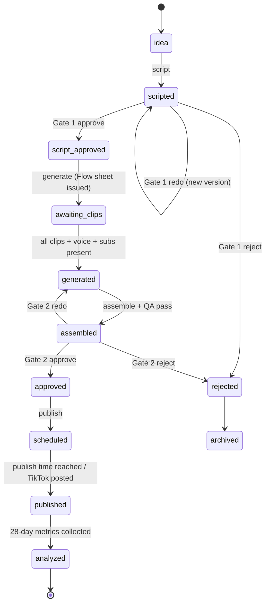

# ARCHITECTURE.md

*Last updated: 2026-10-23*

## 1. Big picture

The factory is a **Python command-line program** called `factory`, with one subcommand per pipeline stage. Every stage reads its work from the SQLite database, does one job, writes results back, and moves each content item to its next **status**.

Because the state lives in the database rather than in memory, any stage can be re-run safely (that's what **idempotent** means), and a crash never loses work.

```mermaid
flowchart LR
    subgraph Local PC (WSL2)
        D[discover] --> I[ideate] --> S[script]
        S --> G1{{Gate 1<br/>script review}}
        G1 -- approve --> GEN[generate]
        G1 -- redo --> S
        GEN --> FLOW[/Owner generates clips<br/>in Google Flow/]
        FLOW --> GEN
        GEN --> A[assemble]
        A --> G2{{Gate 2<br/>final review}}
        G2 -- approve --> P[publish]
        G2 -- redo --> GEN
        P --> L[learn]
        L -. winning patterns .-> I
        DB[(SQLite<br/>data/factory.db)]
        FS[(Assets<br/>data/assets/)]
    end
    subgraph Cloud services
        GEM[Gemini API]
        YT[YouTube Data +<br/>Analytics API]
        TT[TikTok APIs]
        TG[Telegram Bot API]
        WIKI[Wikimedia<br/>Pageviews API]
        GD[Google Drive<br/>backup]
    end
    D --- WIKI & YT
    I --- GEM
    S --- GEM
    G1 --- TG
    G2 --- TG
    P --- YT & TT
    L --- YT & TT
```

**Who runs it:**
- Phase 1: the owner, by typing commands.
- Phase 2 onward: **Windows Task Scheduler**, which calls `wsl.exe` at 01:00 (production batch) and 06:00 (analytics).
- n8n (a visual workflow tool) is optional from Phase 2, only as a dashboard and trigger. All business logic stays in Python.

## 2. Pipeline stages

| Stage | CLI | Input | Output | Status change | Free tool (launch) | Paid upgrade (approx./month) |
|---|---|---|---|---|---|---|
| **discover** | `factory discover` | Channel `seed_topics`, `pillars` | Rows in `trend_signals` | — | Wikimedia Pageviews API; YouTube Data API `search.list` / `videos.list`; Google Trends CSV exported manually by the owner (`factory trends import`) | Not needed |
| **ideate** | `factory ideate` | Signals, catalog history, winning patterns | `contents` rows with score breakdown | new → `idea` | Gemini API free tier; Ollama fallback | Claude API, about €3–8 |
| **script** | `factory script` | `idea` contents with score ≥ threshold | `scripts`, `sources`; Gate 1 request | `idea` → `scripted` | Gemini; local embeddings (`all-MiniLM-L6-v2`) for the similarity check | Claude API |
| **review (Gate 1)** | `factory review --gate script` | `scripted` | `reviews` row | → `script_approved` / `rejected` / back to `scripted` | Terminal (Phase 1); Telegram bot (Phase 2) | — |
| **generate** | `factory generate` | `script_approved` | Flow prompt sheet, voiceover, subtitles, stills, diagrams | → `awaiting_clips` → `generated` | Google Flow (manual, Veo 3.1 Fast); Kokoro-82M; faster-whisper; Pillow; FLUX.1-schnell or Flow for stills | Google AI Pro for more Flow credits, about €22; ElevenLabs Starter, about €6 |
| **assemble** | `factory assemble` | `generated` | `render_youtube.mp4`, `render_tiktok.mp4`, `cover.jpg`, `metadata.json`; automated QA | → `assembled` | FFmpeg + MoviePy | Not needed |
| **review (Gate 2)** | `factory review --gate final` | `assembled` | `reviews` row | → `approved` / `rejected` / back to `generated` | Terminal, later Telegram | — |
| **publish** | `factory publish` | `approved` | `posts` rows | → `scheduled` → `published` | YouTube Data API (scheduled private → public); TikTok Content Posting API (inbox draft) | Not needed |
| **learn** | `factory learn` | `published` posts | `metrics`, `performance_labels`, weekly report | → `analyzed` (after 28-day metrics) | YouTube Analytics API; TikTok Display API; weekly TikTok CSV | Not needed |

Helper commands:
- `factory db init|migrate|backup`
- `factory flow-log --credits N`: logs Flow credits you spent.
- `factory brand build`: rebuilds `assets_static/logo/` (logo, avatar, stings) from the channel's `display_name` and `brand.palette`.
- `factory trends import`: loads Google Trends CSV files you downloaded into `data/inbox/trends/` (weekly, about 5 minutes).
- `factory retry <content_id>`
- `factory status [<content_id>]`
- `factory run-nightly`: runs discover → ideate → script → generate (voice/subs) → assemble for items whose clips are present → review notifications.

## 3. Human-in-the-loop gates

| Gate | When | What the owner sees | Buttons |
|---|---|---|---|
| **Gate 1: Script** | Before any Flow credits are spent | Title, hook, full script, Engineer's Note draft, shot list, sources, score | Approve / Reject (with reason) / Redo |
| **Gate 2: Final** | After assembly and automated QA | 720p preview MP4, cover, title, captions, hashtags, disclosure checklist | Approve / Reject (with reason) / Redo |

- Reject reasons are stored in `reviews.reason` and fed to the learn stage.
- Gate 2 is **never** removed.
- Gate 1 is never fully automatic, because the Engineer's Note needs the owner. In Phase 3 it can switch to `batch_weekly`, where the whole week's scripts are reviewed in one session. The conditions are in `ROADMAP.md`.

## 4. Deployment

| Piece | Runs where | Why |
|---|---|---|
| Python pipeline, SQLite, assets | Owner's PC, inside WSL2 Ubuntu | €0; the PC can run overnight |
| Image and video generation | Cloud (Google Flow, by hand) | No NVIDIA GPU on the PC |
| Voiceover, subtitles, editing, embeddings | Local CPU | Free, unlimited, licensed for commercial use |
| LLM | Gemini API (cloud); Ollama locally as fallback | The free tier covers our volume |
| Scheduling | Windows Task Scheduler → `wsl.exe -d Ubuntu -- bash -lc "cd ~/ai-content-factory && uv run factory run-nightly"` | `cron` inside WSL only runs while WSL is awake |
| Posting at 17:00 | YouTube's own scheduled publishing (`publishAt`) | The PC doesn't need to be on at 17:00 |
| n8n (optional, Phase 2+) | Docker Desktop with WSL integration | A visual dashboard only |
| Backup | Nightly: `factory.db` snapshot plus `config/` to the channel's Google Drive | Survives a laptop failure |

## 5. Scheduling

| Time (Europe/Berlin) | Job | Phase |
|---|---|---|
| 01:00 daily | `factory run-nightly` (production batch, then Gate notifications) | 2+ |
| 06:00 daily | `factory learn` (analytics pull, labels; weekly report on Mondays) | 2+ |
| 02:30 daily | `factory db backup` | 2+ |
| 17:00 daily | Publishing is done by YouTube itself; TikTok drafts are posted by the owner | 2+ |

## 6. Failure handling and cost control

- **Idempotent stages.** Each stage selects items by status and writes outputs to deterministic paths. Re-running a stage skips finished work.
- **Retries.** Only `RetryableError` (network errors, HTTP 429, 5xx) is retried: 3 attempts with exponential backoff waits of 2 s, 4 s and 8 s. After that the item's status becomes `failed` (the previous status is kept in `status_before_failure`) and a Telegram alert is sent.
- **Budgets.** `budgets_per_day` in the channel YAML. Each external call records its usage in `api_usage`. A stage raises `BudgetExceededError` and stops **before** going over budget.
- **`DRY_RUN=true`** (the default) does everything except external writes: no uploads and no public posts. Telegram messages are still sent and are marked "[DRY RUN]".
- **Run log.** Every command invocation creates a `runs` row (`running` → `ok` / `failed` with the error text, secrets masked) and writes JSON-lines logs; the row id is the `run_id` in every log line. Two exceptions: `factory config check` writes only a log line (it must work while the config, and so the database location, is broken), and `factory db init` writes its row after the migrations, because the `runs` table doesn't exist before. Other commands stop with "run `factory db init` first" if there's no database.
- **`DRY_RUN`** comes from `.env` or the environment. Missing means `true`; anything other than `true`/`false` is a `ConfigError`, never a silent `false`.

## 7. Multi-niche config model

Everything niche-specific is configuration. Code reads `config/settings.yaml` (global) plus one `config/channels/<slug>.yaml` per channel. Both are validated with Pydantic, a library that checks data against declared types. A new niche or channel means a new YAML file, a new set of prompt overrides (optional), new accounts, and `secrets/<slug>/` tokens. **No code changes.**

`uv run factory config check` validates both files and prints a summary, or one readable error line per problem (file, key, reason). The models in `src/factory/config.py` enforce these rules (D-053):
- Unknown keys are errors, so typos are caught. Every key in the shapes below is required except `prompts_dir`.
- The channel `slug` must match its file name; `timezone` must be a real time zone; times are `HH:MM`; colors are `#RRGGBB`; each format has `min_s < max_s`; `weekly_plan` may only use enabled formats.
- **Policy guards:** `gates.final` only accepts `required` (Gate 2 is never removed) and `platforms.*.ai_disclosure` only accepts `true`. Loosening either needs a code change and a new decision, not a YAML edit.

`config/settings.yaml` (global; paths are relative to the repo root):

```yaml
paths:
  data_dir: data
  db_path: data/factory.db
  logs_dir: data/logs
  inbox_dir: data/inbox
  assets_dir: data/assets
  assets_static_dir: assets_static
  secrets_dir: secrets
  prompts_dir: prompts
log_level: INFO                # DEBUG | INFO | WARNING | ERROR
schedule:                      # used by the Task Scheduler setup (task 2.11)
  timezone: Europe/Berlin
  nightly_run: "01:00"
  backup: "02:30"
  learn: "06:00"
```

`config/channels/coil-and-cog.yaml` (the shape is authoritative):

```yaml
slug: coil-and-cog
display_name: "Coil & Cog"
status: active                 # active | paused
language: en
timezone: Europe/Berlin

niche:
  name: "How Machines Work"
  promise: "See what moves inside the things you use every day."
  audience: "Curious viewers 18-44 in US/UK/DE; secondary: car & DIY hobbyists"
  pillars:
    - id: machines
      description: "Cars, household and industrial machines"
    - id: everyday_things
      description: "Ordinary objects with hidden mechanisms"
  seed_topics: [alternator, turbocharger, cvt gearbox, zipper, microwave magnetron]  # full list in CONTENT_STRATEGY.md
  blocklist:
    - "weapons or firearm mechanisms"
    - "step-by-step dangerous repairs (mains electricity, airbags, fuel systems, brakes)"
    - "defeating safety or emissions devices"
    - "real brand logos or endorsements"
    - "disasters or accidents with real victims"

formats:
  short:     {enabled: true,  min_s: 30,  max_s: 50,  aspect: "9:16", series: "{object} in 40 seconds"}
  deep_dive: {enabled: true,  min_s: 65,  max_s: 150, aspect: "9:16", series: "Cutaway: {object}"}
  episode:   {enabled: false, min_s: 300, max_s: 600, aspect: "16:9", series: "Coil & Cog: {theme}"}

cadence:
  publish_time: "17:00"
  weekly_plan: {mon: short, tue: deep_dive, wed: short, thu: deep_dive, fri: short}

voice:
  engine: kokoro
  voice_id: am_michael
  speed: 1.0
  target_wpm: 160

brand:
  palette: {bg: "#0E1116", electric: "#00D1FF", heat: "#FF8A00", fluid: "#3A7BFF", text: "#F5F7FA"}
  fonts: {subtitle: "Montserrat-ExtraBold", label: "Inter-SemiBold"}
  disclosure_line: "Visuals AI-generated; script researched and reviewed by a human engineer."

platforms:
  youtube: {enabled: true, handle: "@coilandcog", publish_mode: api_scheduled, category_id: 28, ai_disclosure: true}
  tiktok:  {enabled: true, handle: "@coilandcog", publish_mode: inbox_draft, ai_disclosure: true}

llm:
  provider: gemini             # gemini | ollama
  model: gemini-3.5-flash-lite # free tier: 15 RPM, 500 RPD (D-051)
  fallback_provider: ollama
  fallback_model: "llama3.2:3b"

budgets_per_day:
  gemini_calls: 60
  youtube_units: 3000
  flow_credits: 50

scoring:
  min_virality_score: 65
  similarity_block_threshold: 0.80
  similarity_window: 30

gates:
  script: required             # required | batch_weekly (Phase 3 only; still a human decision)
  final: required              # always required

prompts_dir: prompts/coil-and-cog   # optional overrides; falls back to prompts/default
```

## 8. Content status lifecycle

The full table of transitions is in `DATABASE.md` §4.



From any non-terminal status, an item can move to `failed`. `factory retry` returns it to `status_before_failure`.

## 9. Technology choices

| Concern | Choice | Reason |
|---|---|---|
| Python | 3.12 via `uv` | Libraries support it; `uv` manages versions and packages per project |
| CLI | Typer | Simple, typed CLI commands |
| Config and validation | PyYAML + Pydantic v2 | Readable YAML with strict validation |
| `.env` loading | python-dotenv | Parses `.env` in Python (never sourced by a shell, so values can't leak in shell errors); real environment variables override it |
| Database | SQLite (`sqlite3` standard library) + plain SQL migrations | No server; reliable; Postgres later |
| HTTP | httpx | Modern, timeouts by default |
| Retries | tenacity | Declarative backoff |
| Prompt templates | Jinja2 | Prompts live as files, not inside code |
| LLM | `google-genai` (Gemini); Ollama HTTP | Free tier; local fallback |
| Embeddings | sentence-transformers `all-MiniLM-L6-v2` (Apache 2.0) | Local similarity check, no quota |
| TTS | `kokoro` (Apache 2.0) + `espeak-ng` | Good quality on CPU, commercial use OK |
| Word timing | `faster-whisper` (MIT), model `small.en`, int8 on CPU | Accurate word timestamps |
| Video | FFmpeg (system) + MoviePy | Standard, free |
| Images | Pillow | Diagrams, logo, thumbnails |
| Google APIs | `google-api-python-client`, `google-auth-oauthlib` | Official clients |
| Telegram | `python-telegram-bot` | Mature; long polling, so no public server needed |
| Tests and lint | pytest, ruff | Standard |

## 10. Folder structure

```
ai-content-factory/
├── CLAUDE.md                     # Claude Code entry point (imports key docs)
├── AGENTS.md                     # rules for AI coding agents
├── README.md                     # quick start for humans
├── pyproject.toml                # project + dependencies (managed by uv)
├── uv.lock
├── .python-version               # 3.12
├── .env.example                  # every setting, no real values
├── .env                          # real values (git-ignored)
├── .gitignore
├── docs/                         # source of truth (this folder)
├── config/
│   ├── settings.yaml             # global: paths, log level, schedule defaults
│   └── channels/
│       └── coil-and-cog.yaml     # one file per channel/niche
├── prompts/
│   ├── default/                  # Jinja2 templates: ideate, script, metadata, flow_shot_*, still_image, style_block
│   └── coil-and-cog/             # optional per-channel overrides
├── migrations/
│   └── 001_init.sql
├── src/factory/
│   ├── __init__.py
│   ├── cli.py                    # Typer app: one command per stage
│   ├── config.py                 # load + validate settings and channel profiles
│   ├── db.py                     # connection, migrations, small query helpers
│   ├── models.py                 # Pydantic models mirroring tables
│   ├── errors.py                 # FactoryError hierarchy
│   ├── logging_setup.py          # JSON-lines + console logging, secret redaction
│   ├── budgets.py                # api_usage tracking and budget checks
│   ├── stages/
│   │   ├── discover.py
│   │   ├── ideate.py
│   │   ├── script.py
│   │   ├── generate.py
│   │   ├── assemble.py
│   │   ├── review.py
│   │   ├── publish.py
│   │   └── learn.py
│   ├── integrations/
│   │   ├── gemini.py
│   │   ├── ollama.py
│   │   ├── wikimedia.py
│   │   ├── youtube.py            # Data API: search, upload, schedule
│   │   ├── youtube_analytics.py
│   │   ├── tiktok.py             # inbox upload + display API
│   │   ├── telegram_bot.py
│   │   ├── kokoro_tts.py
│   │   ├── whisper_align.py
│   │   └── gdrive_backup.py
│   └── media/
│       ├── ffmpeg.py             # thin wrappers around ffmpeg/ffprobe
│       ├── brand.py              # logo, avatar and sting built from the channel YAML
│       ├── subtitles.py          # ASS generation with word highlight
│       ├── diagrams.py           # Pillow overlay layers
│       ├── stills.py             # Ken Burns / parallax animation
│       ├── thumbnails.py
│       └── qa.py                 # automated quality checks
├── tests/
│   ├── unit/
│   ├── integration/              # marked; calls real APIs; run manually
│   ├── fakes/                    # fake Gemini/YouTube/TikTok/Telegram clients
│   └── fixtures/                 # tiny test clips (ffmpeg testsrc), sample scripts
├── assets_static/
│   ├── fonts/                    # Montserrat, Inter (OFL)
│   ├── logo/                     # logo PNGs, sting MP4s
│   └── music/youtube_audio_library/   # vetted tracks + license notes
├── ops/
│   └── windows/                  # Task Scheduler XML + how-to (Phase 2)
├── n8n/                          # optional workflows export (Phase 2+)
├── secrets/                      # OAuth client + tokens per channel (git-ignored)
│   └── coil-and-cog/
└── data/                         # git-ignored
    ├── factory.db
    ├── logs/                     # factory-YYYY-MM-DD.jsonl
    ├── inbox/flow/<content_id>/  # owner drops Flow downloads here
    ├── inbox/trends/             # owner drops Google Trends CSV exports here (moved to imported/ after loading)
    └── assets/<channel_slug>/<content_id>/
```

From Windows, the Flow inbox folder is reachable at `\\wsl$\Ubuntu\home\farrukh\ai-content-factory\data\inbox\flow\`.
