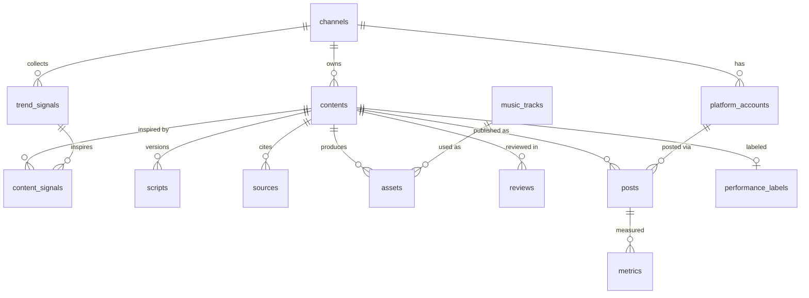

# DATABASE.md

*Last updated: 2026-10-23. Engine: SQLite 3 at `data/factory.db`. Migrations: `migrations/NNN_name.sql`, applied in order by `factory db migrate`. Upgrade path: Postgres (Phase 4).*

## 1. Conventions

- Table names are plural, `snake_case` (`contents`, `posts`). Columns are `snake_case`.
- Every table has a primary key `id INTEGER PRIMARY KEY` (auto-increment) unless noted.
- Foreign keys are named `<singular_table>_id` (`content_id`, `channel_id`). `PRAGMA foreign_keys = ON` is set on every connection.
- Timestamps are stored as `TEXT` in ISO 8601 **UTC** (`2026-10-22T15:00:00Z`) and named `*_at`. Local time is only for display.
- Enumerations (fixed lists of allowed values) are `TEXT` with a `CHECK (... IN (...))` constraint and listed in this doc.
- JSON blobs are `TEXT` columns named `*_json`, always valid JSON.
- Money isn't stored at this stage.
- Never delete content rows; use the status `archived`.
- `PRAGMA journal_mode = WAL` lets readers and writers work at the same time, so the Telegram bot and the stages don't block each other.
- **Migrations** are applied in number order, each in one transaction. The number of the last applied file is stored in SQLite's built-in `PRAGMA user_version`, so there's no migrations table (D-054). `factory db init` creates the file, applies pending migrations and upserts the channel rows from YAML; it's safe to re-run.
- **Rules the database enforces itself** (D-054), so a code bug can't break them: `posts.ai_disclosure` must be 1 (D-039); `contents.affiliate_links_json` must be `NULL` (D-009); a `reviews` row with `reject` or `redo` needs a non-empty `reason`; at most one `scripts` row per content has `is_current = 1` (partial unique index); `scripts` has `UNIQUE(content_id, version)`. `contents.pillar` and `contents.hook_type` have no `CHECK`, because their values come from each channel's YAML and the content strategy.

## 2. Entity relationships



## 3. Tables

### `channels`
| Column | Type | Notes |
|---|---|---|
| id | INTEGER PK | |
| slug | TEXT UNIQUE NOT NULL | Matches `config/channels/<slug>.yaml`, e.g. `coil-and-cog` |
| display_name | TEXT NOT NULL | `Coil & Cog` |
| niche | TEXT NOT NULL | `How Machines Work` |
| status | TEXT | `active` \| `paused` |
| created_at | TEXT | |

The YAML is the source of truth for settings. This row exists so foreign keys work. `factory db init` inserts or updates it from the YAML.

### `platform_accounts`
| Column | Type | Notes |
|---|---|---|
| id | INTEGER PK | |
| channel_id | INTEGER FK → channels | |
| platform | TEXT | `youtube` \| `tiktok` \| `instagram` \| `facebook` |
| handle | TEXT | `@coilandcog` |
| external_account_id | TEXT | YouTube channel ID / TikTok open_id |
| publish_mode | TEXT | `api_scheduled` \| `inbox_draft` \| `manual` |
| enabled | INTEGER | 0/1 |
| UNIQUE(channel_id, platform) | | |

Rows are created or updated from the channel YAML (`platforms.*`) when the first post on that platform is recorded (`db.upsert_platform_account`).

### `trend_signals`
| Column | Type | Notes |
|---|---|---|
| id | INTEGER PK | |
| channel_id | INTEGER FK | |
| source | TEXT | `wikimedia_pageviews` \| `youtube_search` \| `youtube_popular` \| `google_trends_csv` \| `manual` |
| query | TEXT | Topic or search phrase |
| title | TEXT | Article title or video title (for inspiration only); for `google_trends_csv` the region ("Worldwide", "United States", or `unspecified`) |
| url | TEXT | |
| metric_name | TEXT | e.g. `pageviews_7d`, `pageviews_trend_ratio`, `video_views_median_30d` (median views of the 25 most-viewed videos of the last 30 days; top 5 titles in `raw_json`), `trends_interest` (Google's 0–100 relative score), `trends_ratio` |
| metric_value | REAL | |
| observed_at | TEXT | |
| raw_json | TEXT | Raw API response fragment (no personal data) |

### `contents`, the central table (one row = one video)
| Column | Type | Notes |
|---|---|---|
| id | INTEGER PK | Also the asset folder name, zero-padded to 6 digits (`000042`) |
| channel_id | INTEGER FK | |
| format | TEXT | `short` \| `deep_dive` \| `episode` |
| pillar | TEXT | One of the channel YAML's pillar ids, e.g. `vehicles` \| `air_and_sea` \| `industry_and_energy` (items made before D-073 keep `machines` / `everyday_things`) |
| object_name | TEXT | e.g. `alternator` |
| working_title | TEXT | |
| angle | TEXT | One sentence: what's new or interesting |
| hook_type | TEXT | See `CONTENT_STRATEGY.md` §6 |
| beat_order | TEXT | `classic` \| `context_first` \| `action_first` \| `cold_open` |
| virality_score | INTEGER | 0–100 |
| score_breakdown_json | TEXT | Per-criterion scores, `trend_signal` with `trend_detail`, Gemini's `reason`, `suggested_hook`, model and prompt version (D-080) |
| status | TEXT | See §4 |
| status_before_failure | TEXT | Set when the status becomes `failed` |
| status_reason | TEXT | Last error or reject reason |
| planned_publish_at | TEXT | UTC slot from the weekly plan (`factory plan`); set together with `hook_type` and `beat_order`, which the script stage must then use |
| affiliate_links_json | TEXT | **Disabled at launch**; always `NULL` |
| created_at / updated_at | TEXT | |

### `content_signals`
| Column | Type | Notes |
|---|---|---|
| content_id | INTEGER FK | |
| signal_id | INTEGER FK → trend_signals | |
| PK(content_id, signal_id) | | |

### `scripts`
| Column | Type | Notes |
|---|---|---|
| id | INTEGER PK | |
| content_id | INTEGER FK | |
| version | INTEGER | 1, 2, … (each Gate 1 "redo" creates a new version) |
| hook | TEXT | |
| body_text | TEXT | Full narration text, final spelling: hook + body + Engineer's Note + loop line, joined in speaking order (the script stage stores the parts separately too) |
| engineer_note | TEXT | Owner-approved insight |
| loop_line | TEXT | |
| word_count | INTEGER | |
| est_duration_s | REAL | `word_count / voice.target_wpm * 60` (142 wpm for Coil & Cog, D-066) |
| shot_list_json | TEXT | List of `{n, beat, kind: flow_clip\|still\|diagram, description, duration_s, prompt_vars}`; a flow_clip's `prompt_vars` holds the film shot `hero_look`, `scene`, `camera`, `end_frame` (+ `energy` on the flow beat; D-092); diagram shots also carry `labels` (1–4, ≤4 words) and `energy` (D-067) |
| similarity_max | REAL | Highest cosine similarity to the current scripts of the last `similarity_window` other items (rejected/archived skipped), stored by the script stage; `NULL` = written before task 1.13 (D-076) |
| llm_provider / llm_model | TEXT | |
| prompt_version | TEXT | First 10 hex chars of a SHA-256 over the template and its includes; system and user prompt joined with `+` (D-057) |
| is_current | INTEGER | 0/1; only one current version per content |
| created_at | TEXT | |

### `sources`
| Column | Type | Notes |
|---|---|---|
| id | INTEGER PK | |
| content_id | INTEGER FK | |
| url | TEXT | |
| title | TEXT | |
| publisher | TEXT | e.g. Wikipedia, Bosch, a university |
| claim | TEXT | Which fact in the script it supports |
| accessed_at | TEXT | |

At least 2 sources are required before Gate 1.

### `assets`
| Column | Type | Notes |
|---|---|---|
| id | INTEGER PK | |
| content_id | INTEGER FK | |
| kind | TEXT | `flow_sheet` \| `flow_clip` \| `still` \| `still_anim` \| `diagram` \| `voiceover` \| `subtitles` \| `music` \| `render_youtube` \| `render_tiktok` \| `preview` \| `cover` \| `thumbnail` \| `metadata` |
| shot_n | INTEGER | Shot number for clips, stills and diagrams; otherwise NULL |
| path | TEXT | Relative to the repo root |
| sha256 | TEXT | Detects changed or duplicate files |
| generator | TEXT | `google_flow` \| `kokoro` \| `faster_whisper` \| `pillow` \| `ffmpeg` \| `flux_schnell` \| … |
| model | TEXT | e.g. `veo-3.1-fast`, `am_michael` |
| prompt | TEXT | Exact prompt used (for generative assets) |
| music_track_id | INTEGER FK → music_tracks | For `kind = music` |
| license | TEXT | e.g. `own_work`, `google_flow_output`, `apache-2.0`, `youtube_audio_library` |
| license_url | TEXT | |
| duration_s / width / height | REAL / INTEGER / INTEGER | |
| created_at | TEXT | |

### `music_tracks`
| Column | Type | Notes |
|---|---|---|
| id | INTEGER PK | |
| title / artist | TEXT | |
| source | TEXT | `youtube_audio_library` |
| platform_scope | TEXT | `youtube` (never used in TikTok renders) |
| attribution_required | INTEGER | 0/1; if 1, the attribution text goes into the description |
| attribution_text | TEXT | |
| license_url | TEXT | |
| mood / bpm | TEXT / INTEGER | |
| path | TEXT | `assets_static/music/youtube_audio_library/...` |
| added_at | TEXT | |

### `reviews`
| Column | Type | Notes |
|---|---|---|
| id | INTEGER PK | |
| content_id | INTEGER FK | |
| gate | TEXT | `script` \| `final` |
| decision | TEXT | `approve` \| `reject` \| `redo` |
| reason | TEXT | Required for reject and redo |
| channel | TEXT | `cli` \| `telegram` |
| telegram_message_id | INTEGER | |
| decided_at | TEXT | |

### `posts` (one row per content per platform)
| Column | Type | Notes |
|---|---|---|
| id | INTEGER PK | |
| content_id | INTEGER FK | |
| platform_account_id | INTEGER FK | |
| platform | TEXT | `youtube` \| `tiktok` |
| status | TEXT | `pending` \| `uploaded` \| `scheduled` \| `draft_sent` \| `published` \| `failed` |
| external_id | TEXT | YouTube videoId / TikTok publish_id, later the video id |
| url | TEXT | |
| title / caption / hashtags | TEXT | Platform-specific |
| ai_disclosure | INTEGER | Must be 1 |
| privacy | TEXT | `private` \| `unlisted` \| `public` \| `self_only` |
| scheduled_for | TEXT | |
| published_at | TEXT | |
| dry_run | INTEGER | 1 if created in DRY_RUN mode (never real) |
| UNIQUE(content_id, platform) | | |

A manual post (`factory publish --manual`, D-072) is stored as `status = published`, `privacy = public`, `dry_run = 0` (the owner posted it, so it is real even while `DRY_RUN=true`), with the video id taken from the link. YouTube rows keep the title and full description; TikTok rows keep the caption (`title` is empty).

### `metrics`
| Column | Type | Notes |
|---|---|---|
| id | INTEGER PK | |
| post_id | INTEGER FK | |
| checkpoint | TEXT | `24h` \| `72h` \| `7d` \| `28d` |
| source | TEXT | `api` \| `csv` \| `manual` |
| views | INTEGER | |
| avg_view_duration_s | REAL | |
| avg_view_pct | REAL | 0–100 |
| stayed_to_watch_pct | REAL | 0–100, NULL if unavailable |
| likes / comments / shares | INTEGER | |
| subscribers_gained | INTEGER | YouTube only |
| watch_time_min | REAL | |
| collected_at | TEXT | |
| UNIQUE(post_id, checkpoint) | | |

### `performance_labels`
| Column | Type | Notes |
|---|---|---|
| content_id | INTEGER PK FK | |
| label | TEXT | `winner` \| `average` \| `loser` |
| basis_json | TEXT | Numbers used (median, views, pct values) |
| overridden_by_owner | INTEGER | 0/1 |
| notes | TEXT | |
| computed_at | TEXT | |

### `runs`
| Column | Type | Notes |
|---|---|---|
| id | INTEGER PK | Also used as the `run_id` in logs |
| command | TEXT | e.g. `script`, `run-nightly` |
| channel_slug | TEXT | |
| started_at / finished_at | TEXT | |
| status | TEXT | `running` \| `ok` \| `partial` \| `failed` |
| items_processed / items_failed | INTEGER | |
| dry_run | INTEGER | |
| error | TEXT | |

### `api_usage`
| Column | Type | Notes |
|---|---|---|
| id | INTEGER PK | |
| channel_id | INTEGER FK | |
| service | TEXT | `gemini` \| `youtube_data` \| `youtube_analytics` \| `tiktok` \| `flow` \| `wikimedia` \| `telegram` |
| usage_date | TEXT | Local date `YYYY-MM-DD` (Europe/Berlin) |
| units | INTEGER | Calls, quota units or credits |
| UNIQUE(channel_id, service, usage_date) | | Incremented by an upsert (insert, or update if the row exists) |

Flow credits are entered manually with `factory flow-log --credits 20`.

## 4. Content status lifecycle

| Status | Meaning | Set by | Next |
|---|---|---|---|
| `idea` | Scored idea | ideate | `scripted`, `archived` |
| `scripted` | Script draft waiting for Gate 1 | script | `script_approved`, `scripted` (redo), `rejected` |
| `script_approved` | Owner approved the script | review | `awaiting_clips` |
| `awaiting_clips` | Flow sheet issued; waiting for the owner's clips in `data/inbox/flow/<id>/` | generate | `generated` |
| `generated` | Clips, voice, subtitles, stills and diagrams all present. Built up task by task: since task 1.6 it means every Flow clip (checked: readable, portrait, ≥3 s) plus `voice.wav`; subtitles (1.7) and stills/diagrams (1.8) join when built | generate | `assembled` |
| `assembled` | Renders done and automated QA passed | assemble | `approved`, `generated` (redo), `rejected` |
| `approved` | Owner approved the final video | review | `scheduled`, `published` (manual post, D-072) |
| `scheduled` | YouTube scheduled and/or TikTok draft sent | publish | `published` |
| `published` | Live on at least one platform | publish | `analyzed` |
| `analyzed` | 28-day metrics stored and labeled | learn | (end) |
| `rejected` | Owner rejected it | review | `archived` |
| `failed` | Stage error after retries | any | `status_before_failure` via `factory retry` |
| `archived` | Kept for history, ignored by stages | owner / system | (end) |

`db.note_reason()` sets `status_reason` without changing the status (used when QA fails and the item stays `generated`).

Rules for `failed` (enforced by `db.set_status()`):
- Any **working** status can move to `failed`: `idea`, `scripted`, `script_approved`, `awaiting_clips`, `generated`, `assembled`, `approved`, `scheduled`, `published`. `analyzed`, `rejected`, `archived` and `failed` can't, because no stage works on them. The previous status is saved in `status_before_failure`.
- `failed` can only move back to `status_before_failure` (what `factory retry` does); that clears `status_before_failure`.
- `scripted → scripted` (Gate 1 redo) is the only move to the same status.

The main path is the one in the PRD: **idea → scripted → generated → approved → published → analyzed**. The extra statuses (`script_approved`, `awaiting_clips`, `assembled`, `scheduled`) mark the waiting points between those steps.

## 5. Asset storage layout

```
data/assets/<channel_slug>/<content_id 6 digits>/
├── flow_sheet.md            # prompts the owner pastes into Google Flow
├── clips/shot_01.mp4 …      # copied from data/inbox/flow/<content_id>/
├── stills/still_03.png …
├── stills/still_03_anim.mp4
├── diagrams/diag_02.png …
├── voice.wav
├── subs.ass
├── music.txt                # chosen track id (YouTube render only)
├── render_youtube.mp4
├── render_tiktok.mp4
├── preview_720p.mp4         # small file for Telegram review
├── cover.jpg
├── thumbnail.jpg            # Episodes only
├── qa_report.json           # every automated QA check: ok true/false/null + detail
└── metadata.json            # see below
```

**`metadata.json`** (task 1.11, D-071): `youtube` {`title` (≤70 chars), `description` (summary, music attribution if required, 3 hashtags; no source links, D-077), `hashtags`, `category_id`, `contains_synthetic_media: true`, `made_for_kids: false`, `render`}; `tiktok` {`caption` (hook + 3–5 hashtags), `hashtags`, `ai_generated_label: true`, `add_tiktok_sound: true`, `render`}; `sources`; `music`; `cover`; `generated_by` {`model`, `prompt_version`}. Gemini writes only title, summary, caption and hashtags; code writes the rest.

**Owner's Flow inbox naming:** save each downloaded clip as `data/inbox/flow/<content_id>/shot_NN.mp4`, matching the shot numbers in `flow_sheet.md`. The generate stage copies the clips into `clips/`, records them in `assets`, and only then moves the item to `generated`.

**Retention:** raw clips are kept locally for 180 days after `analyzed`, then deleted by a cleanup task in Phase 3. The database and renders are kept for good.
